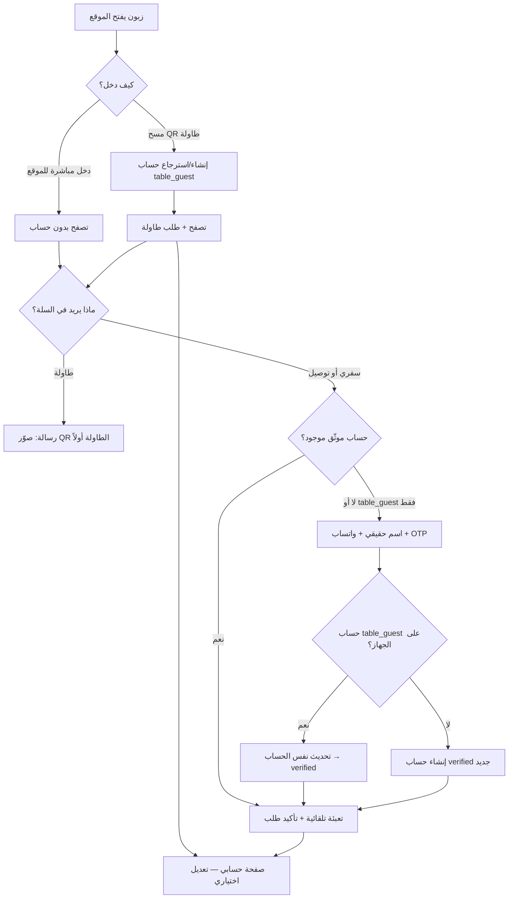

# خطة حسابات الزبائن في الموقع (بن مفيد)

> **الغرض من هذا الملف:** شرح الترتيبة الكاملة قبل البرمجة — مسار الطاولة (QR) ومسار السفري/التوصيل، وكيف يُنشأ الحساب، وصفحة البروفايل، وOTP واتساب.

---

## 1. الوضع الحالي في المشروع (قبل التطوير)

| العنصر | الوضع الآن |
|--------|------------|
| جدول `customers` | **عملاء الموردين** لفواتير الشراء في لوحة الإدارة — **ليس** زبائن الموقع |
| جدول `users` | **موظفون فقط** (مدير، كاشير) — تسجيل دخول `/login` |
| مسح QR الطاولة | كاميرا الجوال → رابط `/t/{token}` → القائمة → سلة → طلب |
| جلسة الطاولة | `customer_session_token` عشوائي في `localStorage` — **ليس حساباً** |
| سفري / توصيل | الاسم + الهاتف في السلة → طلب مباشرة — **بدون OTP وبدون حساب** |
| صفحة `/profile` | لموظف مسجّل دخوله (Breeze) — **ليست للزبون** |

**الخلاصة:** الزبون اليوم «ضيف» أو «جلسة طاولة مؤقتة»، وليس لديه حساب شخصي دائم على الموقع.

---

## 2. الهدف المطلوب (بعد التطوير)

نريد نوعين من **حساب زبون الموقع** (`StorefrontCustomer` — اسم مقترح للموديل الجديد):

1. **حساب طاولة (سريع):** يُنشأ تلقائياً عند أول مسح QR للطاولة — بيانات افتراضية — يعمل فوراً — يعدّل بروفايله لاحقاً.
2. **حساب موثّق (سفري/توصيل):** يُنشأ أو يُربط عند أول طلب سفري أو توصيل — **إلزامي:** رقم واتساب + OTP — بعدها حساب نظامي كامل.

في الحالتين: صفحة **بروفايل** (`/account` أو `/profile`) لتعديل الاسم ورقم الواتساب وغيرها.

### 2.1 السيناريو الأهم: طاولة أولاً ← سفري لاحقاً (ترقية الحساب)

هذا هو المسار الذي يصفه الشريك بوضوح:

```
الزبون أول مرة: صوّر QR الطاولة وطلب من الطاولة
        ↓
النظام أنشأ له حساباً تلقائياً:
   الاسم: "زبون — طاولة 5" (افتراضي)
   الهاتف: فارغ
   account_type: table_guest
        ↓
بعد أيام / نفس الجهاز: يفتح الموقع ويختار «سفري»
        ↓
【 إلزامي — ليس اختيارياً 】
   يظهر نموذج: الاسم الحقيقي + رقم الواتساب
   (لا نستخدم الاسم الافتراضي "زبون طاولة" في طلب السفري)
        ↓
OTP واتساب → تحقق من الرقم
        ↓
النظام **يحدّث نفس الحساب** (لا ينشئ حساباً جديداً):
   name ← الاسم الذي أدخله الزبون
   phone ← رقم الواتساب
   phone_verified_at ← now()
   account_type ← verified  (صار حساباً نظامياً)
        ↓
كل طلباته السابقة من الطاولة تبقى مربوطة بنفس storefront_customer_id
        ↓
الزيارات القادمة (سفري/توصيل): بياناته جاهزة — بدون إعادة إدخال
```

**القاعدة:** حساب `table_guest` على نفس الجهاز (نفس cookie) + أول طلب سفري/توصيل = **إكمال البروفايل + OTP** ثم **تحديث** السجل وليس إنشاء مكرر.

---

## 3. مفاهيم أساسية

### 3.1 حساب زبون الموقع (`StorefrontCustomer`)

كيان جديد **منفصل** عن:
- `User` (الموظفين)
- `Customer` (موردي الفواتير)

| حقل مقترح | الشرح |
|-----------|--------|
| `id` | معرّف داخلي |
| `uuid` | معرّف عام آمن للروابط |
| `name` | اسم العرض |
| `phone` | رقم واتساب بصيغة E.164 |
| `phone_verified_at` | null = غير موثّق، تاريخ = اجتاز OTP |
| `account_type` | `table_guest` \| `verified` |
| `default_table_id` | آخر طاولة رُبط بها (اختياري) |
| `created_via` | `table_qr` \| `takeaway_otp` \| `delivery_otp` |
| `is_active` | تفعيل/إيقاف |

### 3.2 التوثيق (Authentication)

| نوع الحساب | كيف «يدخل» الزبون؟ |
|------------|---------------------|
| طاولة (أول مرة) | Cookie / token بعد مسح QR — **بدون OTP في البداية** |
| طاولة (لاحقاً) | نفس الجهاز يتذكر الحساب عبر cookie |
| سفري/توصيل | OTP واتساب → جلسة زبون (`storefront_customer_session`) |

> **لا نخلط** جلسة الزبون مع جلسة الموظف. مسار `/login` يبقى للموظفين فقط.

### 3.3 OTP عبر واتساب (Mirsalli)

- إرسال رمز 4–6 أرقام لرقم الزبون عبر `WhatsAppService` الموجود.
- صلاحية الرمز: 5–10 دقائق، حد محاولات، حد إرسال متكرر.
- بعد التحقق: `phone_verified_at = now()` و `account_type = verified`.

---

## 4. المسار الأول: الطاولة (مسح QR)

### 4.1 الترتيب خطوة بخطوة

```
الزبون يصوّر QR الطاولة بكاميرا الجوال
        ↓
يفتح الرابط: /t/{token}
        ↓
السيرفر: TableEntryController → /products?table_token=...&table_scan=fresh
        ↓
TableOrderingProvider: يفعّل الطاولة + scan_session
        ↓
【 جديد 】 إن لم يكن للجهاز حساب زبون:
        → إنشاء StorefrontCustomer ببيانات افتراضية:
           الاسم: "زبون طاولة {رقم}"
           الهاتف: فارغ
           phone_verified_at: null
           account_type: table_guest
           created_via: table_qr
        → إصدار storefront_customer_token (cookie + localStorage)
        ↓
الزبون يتصفح القائمة ويضيف للسلة
        ↓
السلة → نوع الطلب: طاولة (تلقائي)
        ↓
تأكيد الطلب → Order مربوط بـ storefront_customer_id
        ↓
صفحة الشكر + حفظ جلسة الطاولة (كما اليوم + ربط بالحساب)
```

### 4.2 البيانات الافتراضية (مقترح)

| الحقل | القيمة الافتراضية |
|-------|-------------------|
| الاسم | `زبون — طاولة 5` (من رقم الطاولة) |
| الهاتف | فارغ |
| موثّق؟ | لا |
| يمكنه الطلب؟ | نعم فوراً على الطاولة |

### 4.3 صفحة البروفايل (طاولة)

- رابط من الهيدر أو الفوتر: **«حسابي»**
- يعدّل: **الاسم** (اختياري)، **رقم الواتساب** (اختياري في البداية)
- إذا أضاف رقم واتساب ويريد استخدامه لطلبات سفري لاحقاً → يُطلب منه OTP مرة واحدة لتوثيق الرقم

### 4.4 علاقة مع النظام الحالي

| اليوم | بعد التطوير |
|-------|-------------|
| `customer_session_token` على الطلب | يبقى لملكية الطاولة المفتوحة + يُربط بـ `storefront_customer_id` |
| `table_scan_session` | يبقى كما هو (أمان QR) |
| لا حساب | حساب `table_guest` تلقائي |

---

## 5. المسار الثاني: سفري أو توصيل (أول مرة)

### 5.1 متى يُفعّل؟

عندما يختار الزبون **سفري** أو **توصيل** في السلة **ولم يكن حسابه موثّقاً** (`phone_verified_at` فارغ أو `account_type = table_guest`).

يشمل ذلك:
- زبوناً **جديداً** بدون أي حساب.
- زبوناً **أنشأنا له حساب طاولة** سابقاً (اسم افتراضي + بدون هاتف) — **نفس السيناريو**: يُجبر على إدخال اسمه ورقمه الحقيقيين.

### 5.2 الترتيب خطوة بخطوة

```
زبون → يضيف أطباق → سلة → يختار «سفري» أو «توصيل»
        ↓
【 جديد 】 نموذج قبل التأكيد (إلزامي دائماً لغير الموثّق):
   - الاسم الكامل (إلزامي — حتى لو عنده اسم افتراضي "زبون طاولة")
   - رقم الواتساب (إلزامي)
        ↓
زر «إرسال رمز التحقق»
        ↓
السيرفر: يولّد OTP → يرسله واتساب (Mirsalli)
        ↓
الزبون يدخل الرمز في الموقع
        ↓
التحقق ناجح — المنطق على السيرفر:
   ┌─ لديه cookie حساب table_guest (نفس الجهاز)؟
   │     → **تحديث** نفس السجل: name, phone, verified
   ├─ الرقم مربوط بحساب آخر موجود؟
   │     → دمج/ربط الجلسة بالحساب القديم (سياسة الدمج)
   └─ لا حساب ولا رقم مكرر؟
         → إنشاء StorefrontCustomer جديد (verified)
        ↓
phone_verified_at = now() ، account_type = verified
        ↓
يكمل بيانات التوصيل (الموقع على الخريطة…) إن لزم
        ↓
تأكيد الطلب → Order مربوط بـ storefront_customer_id
        ↓
صفحة الشكر
```

### 5.2.1 ترقية من table_guest إلى verified (تفصيل تقني)

| الخطوة | السلوك |
|--------|--------|
| قبل OTP | الواجهة تعرض حقول الاسم والهاتف **فارغة أو بقيم placeholder** — لا تعرض «زبون — طاولة 5» كاسم جاهز للطلب |
| بعد OTP ناجح | `StorefrontCustomer::upgradeFromTableGuest($customer, $name, $phone)` يحدّث الحقول ويضبط `account_type = verified` |
| الطلبات القديمة | تبقى على نفس `storefront_customer_id` — سجل واحد للزبون |
| واجهة السلة لاحقاً | الاسم والهاتف من البروفايل الموثّق — تعبئة تلقائية |

### 5.3 حفظ مواقع التوصيل (عناوين مسماة)

عند أول طلب **توصيل** (بعد التحقق OTP)، يمكن للزبون:

1. تحديد الموقع على الخريطة + وصف تفصيلي (كما اليوم).
2. تفعيل **«احفظ هذا الموقع»** وإدخال اسم مثل «البيت» أو «العمل» أو «بيت الأهل».
3. النظام يحفظ السجل في `storefront_customer_addresses` مربوطاً بحسابه.

**الزيارة الثانية وما بعدها:**

```
زبون موثّق → سلة → توصيل
        ↓
يظهر قائمة المواقع المحفوظة (البيت، العمل…)
        ↓
يختار موقعاً → تُعبّأ الإحداثيات والوصف تلقائياً
        ↓
أو يضغط «موقع جديد» ويضيف موقعاً آخر (مع خيار الحفظ)
        ↓
تأكيد الطلب
```

| حقل العنوان | الشرح |
|-------------|--------|
| `label` | الاسم الذي يختاره الزبون («البيت») |
| `latitude` / `longitude` | من الخريطة |
| `location_note` | وصف المبنى/الطابق |
| `is_default` | آخر موقع مستخدم أو المفضّل |

- إدارة العناوين من `/account` (عرض + حذف).
- حد أقصى: 10 مواقع لكل حساب (قابل للتعديل في `.env`).

### 5.4 زيارات لاحقة (سفري/توصيل)

```
زبون عنده cookie حساب موثّق
        ↓
السلة تُعبّأ تلقائياً: الاسم + الهاتف من البروفايل
        ↓
لا OTP مرة ثانية (إلا إذا غيّر الرقم من البروفايل)
        ↓
تأكيد مباشر
```

---

## 6. صفحة البروفايل (`/account`)

### 6.1 من يصل إليها؟

أي زبون لديه `storefront_customer_token` (طاولة أو موثّق).

### 6.2 ماذا يعرض؟

| قسم | المحتوى |
|-----|---------|
| المعلومات الشخصية | الاسم، رقم الواتساب (مع شارة «موثّق» إن وُجد OTP) |
| نوع الحساب | زبون طاولة / حساب كامل |
| سجل مختصر | آخر 5–10 طلبات (رقم، تاريخ، إجمالي، حالة) |
| تعديل | حفظ الاسم؛ تغيير الهاتف → OTP جديد |

### 6.3 ما لا نضعه في بروفايل الزبون

- كلمة مرور (الدخول بالجلسة + OTP فقط)
- صلاحيات لوحة الإدارة
- ربط مع جدول `users`

---

## 7. مخطط القرار: أي مسار يُستخدم؟



---

## 8. تغييرات قاعدة البيانات (مقترحة)

### جدول جديد: `storefront_customers`

```
id, uuid, name, phone (nullable unique), phone_verified_at,
account_type, default_restaurant_table_id (nullable),
created_via, is_active, timestamps
```

### جدول جديد: `storefront_customer_otps`

```
id, phone, code_hash, expires_at, attempts, created_at
```

### جدول جديد: `storefront_customer_addresses`

```
id, storefront_customer_id, label, latitude, longitude,
location_note, is_default, timestamps
```

### جدول جديد: `storefront_customer_sessions`

```
id, storefront_customer_id, token_hash, expires_at, last_used_at
```

### تعديل `orders`

```
storefront_customer_id (nullable, FK)
saved_address_id (nullable, FK → storefront_customer_addresses)
```

> `customer_session_token` على الطلب **يبقى** لتمييز «صاحب الطاولة المفتوحة» على نفس الجهاز.

---

## 9. واجهات API مقترحة (للموقع)

| Method | المسار | الوظيفة |
|--------|--------|---------|
| POST | `/api/account/table-bootstrap` | بعد QR: إنشاء/ربط حساب طاولة |
| GET | `/api/account/me` | بيانات الزبون الحالي |
| PATCH | `/api/account/profile` | تحديث الاسم |
| POST | `/api/account/otp/send` | إرسال OTP للواتساب |
| POST | `/api/account/otp/verify` | التحقق وإنشاء/تفعيل الجلسة |
| GET | `/account` | صفحة Inertia للبروفايل |

---

## 10. تجربة المستخدم (UX) — ملخص

| السيناريو | ماذا يرى الزبون |
|-----------|-----------------|
| أول QR طاولة | يدخل القائمة مباشرة — بدون نماذج — اسمه افتراضي في الخلفية («زبون طاولة X») |
| يفتح «حسابي» | يغيّر اسمه ورقمه إن أراد (اختياري قبل السفري) |
| طاولة ثم أول سفري (نفس الجهاز) | **إلزامي:** يدخل اسمه الحقيقي ورقمه → OTP → النظام يحدّث حسابه ويصير نظامي |
| أول سفري (بدون طاولة سابقاً) | اسم + واتساب → «أرسل الرمز» → يدخل OTP → يكمل الطلب |
| سفري ثاني | بياناته جاهزة — ضغطة تأكيد |
| توصيل أول مرة | OTP + خريطة + وصف + **تسمية الموقع وحفظه** (اختياري) |
| توصيل لاحقاً | اختيار من المواقع المحفوظة أو موقع جديد |
| طاولة بدون QR | رسالة واضحة: «صوّر رمز الطاولة من كاميرا جوالك» |

---

## 11. الأمان والقيود

1. **OTP:** حد 3 محاولات خاطئة، إعادة إرسال بعد 60 ثانية، انتهاء الرمز بعد 10 دقائق.
2. **رقم الواتساب:** تنسيق E.164، رقم واحد = حساب واحد (دمج عند التكرار).
3. **جلسة الطاولة:** `scan_session` + geofence يبقيان كما هما — الحساب لا يغني عن مسح QR.
4. **فصل الموظف/الزبون:** middleware منفصل `storefront.customer` ≠ `auth`.
5. **خصوصية:** الزبون يرى طلباته فقط في البروفايل.

---

## 12. مراحل التنفيذ المقترحة (عند الموافقة)

| المرحلة | المحتوى |
|---------|---------|
| **1** | Migration + Model `StorefrontCustomer` + جلسة cookie |
| **2** | Bootstrap حساب عند QR + ربط الطلبات |
| **3** | OTP واتساب + تدفق سفري/توصيل + **ترقية table_guest → verified** (تحديث الاسم والهاتف على نفس السجل) |
| **4** | صفحة `/account` (Inertia) + رابط في StoreLayout |
| **5** | **حفظ مواقع التوصيل** + سجل الطلبات في البروفايل + اختبارات Feature |

---

## 13. أسئلة للتأكيد قبل البرمجة

1. **اسم افتراضي للطاولة:** `زبون طاولة 5` أم `ضيف` فقط؟
2. **ترقية الطاولة → سفري:** مؤكّد — عند أول سفري/توصيل يُجبر على الاسم الحقيقي + الواتساب + OTP ويُحدَّث نفس الحساب (لا يبقى «زبون طاولة» في الطلبات السفرية).
3. **دمج الحساب:** إذا أدخل رقم واتساب مربوطاً بحساب آخر — ندمج أم نرفض؟ (مقترح: دمج إن كان table_guest؛ تنبيه إن كان verified آخر)
4. **مدة بقاء جلسة الزبون:** 30 يوم cookie أم حتى مسح المتصفح؟

---

## 14. ملخص سطر واحد

> **QR الطاولة = حساب سريع باسم افتراضي فوراً؛ أول سفري لاحقاً = يدخل اسمه ورقمه الحقيقيين + OTP فيُحدَّث نفس الحساب ويصير نظامياً؛ الجميع يعدّل بروفايله من `/account`.**

---

*آخر تحديث: بدء التنفيذ — حسابات الزبائن + OTP + حفظ مواقع التوصيل.*
